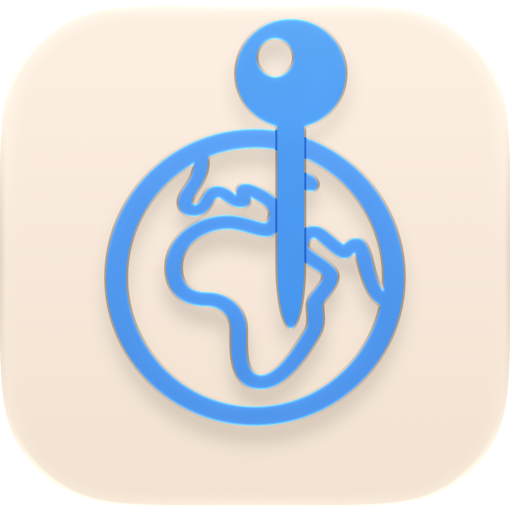

# GeoViewer

<p align="center">
  
</p>

一个 macOS 原生的照片位置查看 / 编辑工具。打开文件或文件夹，在地图上以相册般的缩略图查看照片位置，并把位置友好地写回照片——**只改 GPS，不动照片的其它信息，也不重新压缩图像**。

当前为初始化版本（0.1.0）：核心流程已跑通，可直接构建运行。

---

## 相比 GeoTag 的优化点

| GeoTag 的痛点 | GeoViewer 的做法 |
| --- | --- |
| 英文界面，无中文 | 全中文界面；坐标自动逆地理编码成中文地名（如「浙江省 杭州市 西湖区」） |
| 地图上只有图钉，看不出是哪张照片 | 地图标记直接显示照片缩略图；多张照片按缩放级别自动聚合，带数量角标，点击聚合点放大 |
| 单击地图立刻改位置，容易误操作 | 显式「定位模式」开关：开启后单击地图才写入位置；随时 ⌘Z 撤销，提示条里也有一键撤销 |
| 修改立即落盘，出错难恢复 | 修改先暂存（列表橙色圆点标记），⌘S 统一保存；退出时保护未保存修改；原片备份默认关闭，启动时提示，可在设置中开启 |
| 依赖内置 ExifTool，体积大、黑盒 | 纯 Swift 实现：JPEG/TIFF 走字节级 EXIF 编辑，HEIC 走 ImageIO 元数据复制；无第三方依赖 |
| 写入后不知道是否生效 | 写入后自动回读文件校验，位置未生效会列为失败并提示 |
| 不支持多选批量、坐标输入不便 | 多选批量定位、搜索、拷贝/粘贴坐标到多张照片、手动输入经纬度、⌘9 显示全部照片 |
| 列表、地图、信息混在一起 | 三栏布局（照片列表 / 地图 / 信息面板），两侧都可折叠 |
| 分不清哪些照片是同一批拍的 | 列表显示精确到秒的拍摄时间，并按时间排序，一眼看出连拍与同批照片 |
| 文件和文件夹混成一列 | 列表可按文件夹分组折叠，层级清晰 |
| 想看拍摄点周边路况要手动缩放 | 选中照片按「放大到街道」一键到位（⌘3） |
| 点列表里的照片后地图不跟着走 | 点击列表照片时，若不在视野内自动平移过去，不重置缩放 |
| 只管图形界面 | 额外提供命令行：`--dump`、`--json`、`--set-location`、`--clear-location`，便于批量处理与自动化 |

---

## 功能

- **打开**：文件、文件夹（递归扫描）、拖拽到窗口、访达双击（已声明支持的图片类型）；列表可按所在文件夹分组显示
- **查看**：缩略图列表 + 地图聚合标记 + 详细信息（尺寸、大小、格式、相机/镜头、焦距、光圈、快门、ISO、拍摄时间、GPS 坐标/海拔/方向、中文地名）
  - 列表每行直接显示**精确到秒的拍摄时间**（`2026-10-21 13:28:03`），据此判断照片是否同一批，无需比对经纬度
- **排序**：拍摄时间（早→晚 / 晚→早）、文件名、文件夹路径；无拍摄时间的照片统一排在末尾
- **修改位置**
  - 定位模式：选中照片 → 点击地图 → 批量写入（暂存）
  - **拷贝 / 粘贴坐标**：拷贝一张照片的位置，粘贴到一张或多张选中的照片上（⌘⌥C / ⌘⌥V，右键菜单同样可用）
  - 输入经纬度、删除位置、右键菜单
  - 撤销 / 重做（⌘Z / ⇧⌘Z）；放弃所有修改
- **保存**：⌘S 写入；可设置「改完立即写入」；原片备份**默认关闭**，首次启动会提示，开启后写入前备份到 `~/Pictures/GeoViewer 备份/<时间>/`
- **地图**：标准 / 混合 / 卫星；缩放、显示全部、**一键放大到街道级（看清路）**；聚合点点击放大
  - 点击左侧列表中的照片时，若该照片不在当前视野内会自动平移过去，**保持当前缩放级别**
- **安全**：只读格式（RAW、PNG、WebP 等）可查看但拒绝写入；写入后回读校验；保留文件创建时间、权限与扩展属性
- **命令行**：批量查看 / 写入 / 清除位置

---

## 系统要求

- macOS 14 或更高
- Xcode 16+（Swift 6）或对应 Command Line Tools

## 构建与运行

```bash
swift build                 # 编译
./build_app.sh              # 生成 .build/GeoViewer.app（ad-hoc 签名）
open .build/GeoViewer.app

MAKE_DMG=1 ./build_app.sh   # 额外生成 .build/dist/GeoViewer-0.1.0.dmg
APP_VERSION=0.2.0 ./build_app.sh
```

首次启动若被 Gatekeeper 拦截，可在访达右键 →「打开」，或：

```bash
xattr -dr com.apple.quarantine .build/GeoViewer.app
```

## 命令行

```bash
BIN=.build/debug/GeoViewer

$BIN --dump 照片.jpg 照片.heic        # 查看元数据摘要
$BIN --json 照片.jpg                  # 以 JSON 输出（便于脚本处理）
$BIN --set-location 30.2741,120.1551 照片.jpg 照片.heic
$BIN --clear-location 照片.jpg
```

---

## 目录结构

```
GeoViewer/
├── Package.swift                    # SwiftPM 清单（macOS 14+，无第三方依赖）
├── build_app.sh                     # 组装 .app / 可选 DMG
├── Assets/
│   ├── AppIcon.png                  # 1024×1024 图标源文件（构建脚本自动生成 .icns）
│   └── icon.icon                    # Icon Composer 源文件（矢量，便于后续改图标）
├── scripts/
│   └── metadata_snapshot.swift      # 导出全部 ImageIO 元数据 + 像素哈希，用于回归验证
└── Sources/GeoViewer/
    ├── App/
    │   ├── GeoViewerApp.swift       # 入口、AppDelegate、文件打开、退出保护
    │   ├── AppModel.swift           # 主状态：加载、选择、定位、撤销、保存、地图聚合
    │   └── GeoViewerCommands.swift  # 菜单与快捷键
    ├── Models/
    │   ├── GeoCoordinate.swift      # 经纬度 / GPS 值类型
    │   ├── PhotoDetails.swift       # 照片摘要信息 + 格式白名单
    │   ├── PhotoItem.swift          # 列表条目（已保存位置 vs 暂存位置）
    │   ├── PhotoCluster.swift       # 地图聚合点、地图样式
    │   └── PhotoSortOrder.swift     # 列表排序方式
    ├── Services/
    │   ├── MetadataReader.swift     # ImageIO 元数据读取
    │   ├── MetadataWriter.swift     # 按容器分派的写入入口 + HEIC 路径
    │   ├── JPEGLocationWriter.swift # JPEG APP1(Exif) 段落重写
    │   ├── TIFFLocationEditor.swift # TIFF/EXIF 字节级编辑器
    │   ├── PhotoScanner.swift       # 文件/文件夹展开
    │   ├── ThumbnailProvider.swift  # 缩略图生成与缓存
    │   ├── BackupService.swift      # 写入前备份
    │   ├── PlaceNameService.swift   # 逆地理编码（带缓存）
    │   └── AppSettings.swift        # UserDefaults 设置
    ├── Views/                       # SwiftUI 界面
    ├── Utilities/Formatters.swift   # 展示格式化
    └── CLI/CommandLineTool.swift    # 隐藏命令行入口
```

---

## 元数据写入策略（重点）

需求是「改位置但不改其它信息」，因此没有使用「解码 → 重新编码」的常规路径。

### JPEG

只处理 `APP1(Exif)` 段落，按情况三选一：

1. **原地覆盖**：GPS IFD 已存在且经纬度/引用标签齐全 → 直接覆盖 24 字节的度分秒有理数与 `N/S/E/W` 字符，文件长度都不变；
2. **追加 GPS IFD**：缺少 GPS 标签 → 在文件末尾追加新的 GPS IFD 与新的 IFD0，然后只把 TIFF 头里的 IFD0 指针指向新位置。原有 TIFF 数据一个字节都不移动，所以 MakerNotes 内部偏移、EXIF 缩略图、色彩配置全部继续有效；
3. **新增 APP1**：整张图没有任何 EXIF → 生成一段最小 EXIF（只含 GPS）并插入到 APP0 之后。

清除位置则是把 IFD0 中的 GPS 指针移除（重写 IFD0，不动其它数据）。

### TIFF

对整份 TIFF 使用同一套 IFD 编辑逻辑（TIFF 本身就是 EXIF 的容器）。

### HEIC / HEIF

使用 `CGImageSourceCopyMetadataAtIndex` + `CGImageMetadataCreateMutableCopy` 只增改 GPS 标签，再用 `CGImageDestinationCopyImageSource` 把压缩后的图像数据原样复制。

### 通用

- 先写同目录临时文件，再用 `FileManager.replaceItemAt` 替换，随后恢复创建时间、修改时间与 POSIX 权限；
- 写入完成后立即回读，校验 GPS 是否等于目标值（EXIF 度分秒量化误差按 1e-5° ≈ 1 米容忍），不一致会报告失败；
- 备份可选，默认开启，按日期分目录。

### 实测验证（使用 exiftool 官方测试样张 + iPhone 拍摄的 HEIC）

| 场景 | 结果 |
| --- | --- |
| Canon JPEG（含 MakerNotes / PictureStyle / ExifAux）新增 GPS | 仅新增 `{GPS}`，其余标签逐项一致，像素哈希一致 |
| FujiFilm JPEG（已有 GPS）移动位置 | 仅经纬度与引用方向变化，`GPSVersion`/`DateStamp`/`MapDatum`/`TimeStamp` 保留 |
| 无任何 EXIF 的 JPEG 新增 GPS | 自动插入 APP1，像素哈希一致 |
| 清除 JPEG 位置 | `{GPS}` 整段消失，其余标签逐项一致 |
| TIFF 新增 GPS | 仅新增 `{GPS}`，像素哈希一致 |
| iPhone HEIC 移动 / 清除位置 | GPS 正确；像素哈希一致；`ApertureValue`/`ShutterSpeedValue` 的 APEX 有理数有约 1e-9 的重算误差 |

验证方法：

```bash
swift scripts/metadata_snapshot.swift 原图.jpg 修改后.jpg > snapshot.txt
# 对比预期：只有 {GPS} 段落不同，PIXELHASH 行完全一致
```

---

## 已知限制

- **XMP/IPTC 不更新**：只改 EXIF GPS。若照片的 XMP 里也存了位置，部分软件可能仍读到旧地点。后续会加 XMP 同步。
- **HEIC 走 ImageIO**：实测保留全部标签，但极端私有标签有可能被 ImageIO 归一化（如上面提到的 APEX 有理数）。
- **RAW / PNG 只读**：RAW 私有 IFD 结构复杂，宁可不写；PNG 的 GPS 没有统一标准。
- **原片备份默认关闭**：保存位置时会直接改写原文件。需要留副本的话，请在「设置」里开启「写入前备份原文件」并选择备份文件夹；每次启动在备份处于关闭状态时会提示一次。
- **未接入「照片」图库**：当前只操作磁盘文件，不通过 PhotoKit 修改图库。
- **未做沙盒 / 正式签名 / 公证**：仅本地 ad-hoc 签名，对外分发需要 Developer ID。
- **界面文案硬编码中文**：暂未接入本地化。
- **地图聚合为网格算法**：极大数量照片（数千张）下可再优化为屏幕空间聚类 + 磁盘缩略图缓存。

## 路线图

1. XMP 位置同步；可选接入 ExifTool 作为兼容后端
2. RAW（DNG/CR3/NEF/ARW）写入支持（需样张验证 + 更严格校验）
3. GPX 轨迹按拍摄时间批量定位
4. PhotoKit：读写「照片」图库中的位置
5. 聚合性能、缩略图磁盘缓存、大列表虚拟化
6. 多语言（zh-Hans / en）、DMG 美化、Developer ID 签名与公证
7. 单元测试：大端 TIFF、损坏 EXIF、无 EXIF、MakerNotes、超大 EXIF 等边界

## 需要补充的资料

1. **界面截图**：应用已内置图标（`Assets/AppIcon.png`），但 README 里还没有运行截图，你随手截几张发我即可。
2. **真实样张**：iPhone HEIC / ProRAW、Canon/Nikon/Sony JPEG、扫描件 TIFF、带 GPS 与不带 GPS 各若干，用于回归验证（尤其是大端 TIFF 与 RAW）。
3. **是否要写 RAW**：这是风险最高的部分，需要你确认优先级和可接受的备份策略。
4. **分发信息**：正式 Bundle ID、Developer ID 证书（是否要做签名 + 公证）。
5. **功能优先级**：GPX 轨迹 / 照片图库 / XMP 同步 / 多语言，哪个先做。
6. **最低系统版本**：目前 macOS 14，若要支持更老系统需要调整部分 API。
